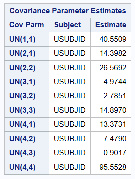
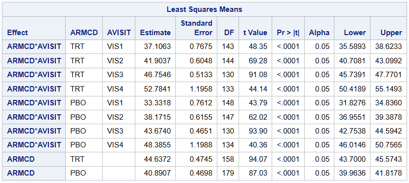
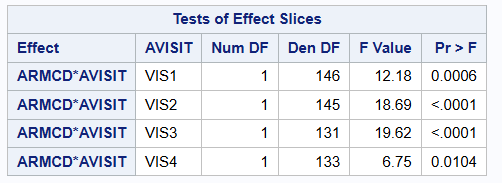
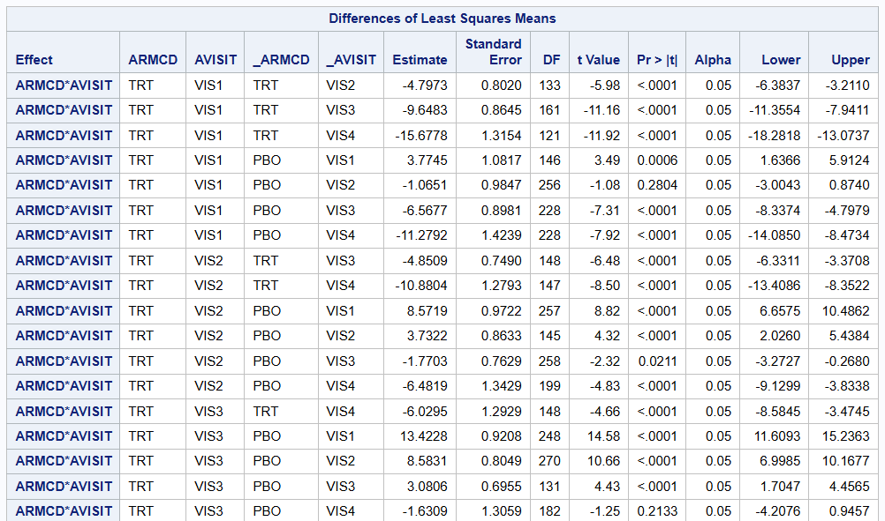
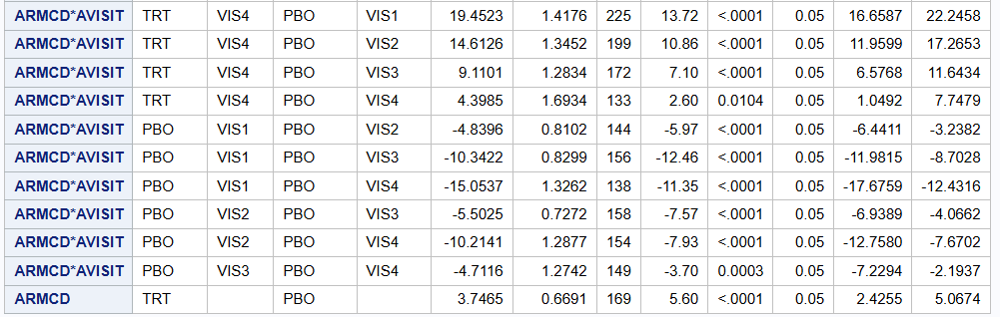
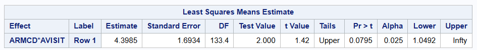

# Mixed Models

## Introduction

A Mixed Model for Repeated Measures (MMRM) is widely applied in clinical trials for longitudinal outcomes. It handles within subject correlation across repeated readings for the same participant and still includes incomplete outcome data under the model assumptions.

In SAS, `PROC MIXED` is used to fit MMRM, with the `MODEL` statement specifying the fixed effects. Repeated measurements are specified through the `REPEATED` statement for within-subject covariance structure. The covariance structure defines the correlation between measurements within a subject. Common covariance structures include unstructured (UN), compound symmetry (CS), and autoregressive order 1 (AR(1)). The Kenward-Roger method can be used to estimate denominator degrees of freedom for statistical inference.

## Data Used

The `fev_data` dataset is included in the R `mmrm` package. It contains repeated FEV1 measurements across visits, together with subject identifiers, treatment assignments, and demographic information.

The variables used in this analysis include:

- `USUBJID`: Subject identifier.
- `FEV1`: Forced expiratory volume in one second.
- `ARMCD`: Treatment group.
- `AVISIT`: Analysis visit.
- `RACE`: Race.
- `SEX`: Sex.

The dataset contains 200 subjects and 800 observations. A total of 537 observations were included in the analysis after applying the model requirements.

The `fev_data` dataset is available in the R [`mmrm` package](https://cran.r-project.org/package=mmrm).

## Fitting the MMRM in SAS

The following example fits an MMRM using an unstructured covariance matrix and the Kenward-Roger method for denominator degrees of freedom.

``` sas
proc mixed data=fev_data;
         
class ARMCD(ref='PBO') AVISIT RACE SEX USUBJID;

model FEV1 = RACE SEX ARMCD ARMCD*AVISIT / ddfm=KR;

repeated AVISIT / subject=USUBJID type=UN r rcorr;

lsmeans ARMCD*AVISIT / cl alpha=0.05 diff slice=AVISIT;

lsmeans ARMCD / cl alpha=0.05 diff;

lsmestimate ARMCD*AVISIT [1,1 4] [-1,2 4] /
    cl upper alpha=0.025 testvalue=2;

ods output lsmeans=lsm
           diffs=diff
           LSMEstimates=est;
run;
    
```

### CLASS Statement

The `CLASS` statement identifies the categorical variables included in the model.

`ARMCD(ref='PBO')` specifies placebo as the reference treatment group.

### MODEL Statement

The `MODEL` statement specifies the dependent variable and fixed effects.

In this example:

- `FEV1` is the dependent variable.
- `RACE` and `SEX` are demographic covariates.
- `ARMCD` represents treatment group.
- `AVISIT` represents analysis visit.
- `ARMCD*AVISIT` represents the treatment-by-visit interaction.

The `DDFM=KR` option requests the Kenward-Roger method for calculating denominator degrees of freedom. This method adjusts the degrees of freedom used for statistical inference in mixed models.

### REPEATED Statement

The REPEATED statement specifies the repeated measurements within each subject and the covariance structure used to model their correlation.

``` sas
repeated AVISIT / subject=USUBJID type=UN r rcorr;
```

- `AVISIT` identifies the repeated measurement occasions.
- `SUBJECT=USUBJID` identifies the subject within which measurements are correlated.
- `TYPE=UN` specifies an unstructured covariance matrix.
- `R` requests the estimated covariance matrix.
- `RCORR` requests the estimated correlation matrix.

An unstructured covariance matrix estimates a separate variance for each visit and a separate covariance for each pair of visits. It does not impose a particular pattern on the correlations between repeated measurements.

Other covariance structures can also be specified, including compound symmetry `(TYPE=CS)` and first-order autoregressive `(TYPE=AR(1))`.

### LSMEANS Statement

The LSMEANS statement calculates least squares means (`LS-means`), which are model-adjusted means for the specified effects.

The following statement estimates the `LS-means` for each treatment group at each visit:

``` sas
lsmeans ARMCD*AVISIT / cl alpha=0.05 diff slice=AVISIT;
```

The options are:

- `CL` requests confidence limits for the LS-means and their differences.
- `ALPHA=0.05` specifies a 95% confidence level.
- `DIFF` requests pairwise differences between LS-means.
- `SLICE=AVISIT` requests tests of the treatment effect separately at each visit.

The `SLICE=AVISIT` option is particularly useful when the model includes a treatment-by-visit interaction. It evaluates the treatment effect within each visit rather than treating the interaction as a single overall comparison.

The following statement calculates the overall treatment LS-means:

``` sas
lsmeans ARMCD / cl alpha=0.05 diff;
```

This requests the LS-means for each treatment group across visits and the difference between the treatment groups.

### LSMESTIMATE Statement

The LSMESTIMATE statement specifies a custom linear contrast of the LS-means. It can be used to test a treatment difference against a specified hypothesized value.

``` sas
lsmestimate ARMCD*AVISIT [1,1 4] [-1,2 4] /
    cl upper alpha=0.025 testvalue=2;
```

In this example, the contrast compares the treatment groups at visit 4 and tests whether the treatment difference exceeds a superiority margin of 2.

The options are:

- `CL` requests confidence limits.
- `UPPER` requests a one-sided upper confidence limit.
- `ALPHA=0.025` specifies the significance level.
- `TESTVALUE=2` specifies the hypothesized treatment difference.

### ODS OUTPUT Statement

The `ODS OUTPUT` statement saves selected PROC MIXED output tables as SAS datasets for further analysis or reporting.

``` sas
ods output lsmeans=lsm
           diffs=diff
           LSMEstimates=est;
```

The output datasets are: 

- `LSM`: Contains the least squares means.
- `DIFF`: Contains the differences between least squares means.
- `EST`: Contains the custom LSMESTIMATE results.

These datasets can be used for additional processing, reporting, or exporting results.

## SAS Results

### Model Information and Fit Statistics

The model was fitted using restricted maximum likelihood (REML), an unstructured covariance matrix, and the Kenward-Roger method for denominator degrees of freedom.

### Covariance Parameter Estimates

The covariance parameter estimates show the estimated variance and covariance components for the unstructured covariance matrix.

```{r}
#| label: fig-mmrm-covariance
#| echo: false


```

### Least Squares Means

The LS-means table displays the adjusted mean FEV1 for each treatment group at each visit, together with standard errors and 95% confidence intervals.

```{r}
#| label: fig-mmrm-lsmeans
#| echo: false


```

The overall treatment LS-means are also calculated using the `LSMEANS ARMCD` statement.

### Tests of Treatment Effects at Each Visit

The `SLICE=AVISIT` option produces tests of the treatment effect separately at each visit. The resulting table reports the F-statistic and p-value for each visit.

```{r}
#| label: fig-mmrm-slice-tests
#| echo: false


```

### Differences of Least Squares Means

The differences table reports pairwise comparisons of the LS-means, including estimated differences, standard errors, degrees of freedom, t-statistics, p-values, and confidence intervals.

```{r}
#| label: fig-mmrm-differences
#| echo: false


```

```{r}
#| label: fig-mmrm-differences2
#| echo: false


```

### Custom LSMESTIMATE Results

The custom contrast estimates the treatment difference at visit 4 and tests it against the specified superiority margin of 2.

```{r}
#| label: fig-mmrm-lsestimate
#| echo: false


```

For this example, the estimated contrast is 4.3985, with a one-sided p-value of 0.0795. Since this p-value is greater than the specified significance level of 0.025, the result does not demonstrate statistically significant superiority over the margin of 2.

## References

- [mmrm R package](https://cran.r-project.org/web/packages/mmrm/) — source of the fev_data example dataset.
- [SAS PROC MIXED Documentation](https://documentation.sas.com/doc/en/pgmsascdc/v_081/statug/statug_mixed_overview.htm).
